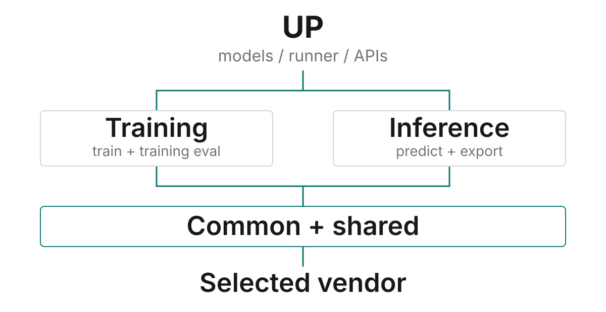

# United Perception Hardware

[](https://github.com/jingfengou/United-Perception-Hardware/actions/workflows/hardware-boundaries.yml)

**保留 UP 的算法与配方，只适配硬件差异。**

基于 [ModelTC/United-Perception](https://github.com/ModelTC/United-Perception)，将设备、专用算子和厂商 SDK 收入同仓独立包 [`up-platform`](packages/up-platform/)。采用 LightX2V 风格的设备后端、算子注册与工厂：**算子按“类别 → 厂商”组织**，训练与独立推理分开适配，公共能力只维护一份；原有 `up.accelerator`、算子导入和 `.apply()` 入口继续兼容。

[使用手册](docs/platform/README.md) · [接口定义](docs/platform/INTERFACES.md) · [新增厂商](docs/platform/ADDING_VENDOR.md) · [能力矩阵](docs/platform/CAPABILITIES.md) · [验证记录](docs/reports/README.md)

## 验证状态

当前 LightX2V 风格重构已在 RTX 4090 / C500 做真实回归：比较 `ad36d77 → 71d9812`，同平台保持相同配置、权重、seed=131 和数值策略。四模型共 16 次完整固定预算、30,400 次更新；**不是完整 ImageNet/COCO 收敛，也不是跨厂商精度等价证明**。[结果、环境与复现](docs/reports/REARCHITECTURE_HARDWARE_20261023.md)

| 范围 | 实测结论 |
| --- | --- |
| NVIDIA native | 四模型重构前后全部 loss、最终权重、指标与最终预测逐位一致；独立编译扩展，32 项原生操作对照通过 |
| C500 显式 v2 | 四模型同策略重构前后完整预算逐位一致；两平台均通过训练内 eval、模型/优化器/调度器恢复及全部留出批次独立推理 |
| C500 native | 短程严格对照仅 ViT 通过；ResNet、YOLO、DETR 在同版本重复中也有差异。固定同一权重后的四模型短程跨版本独立推理逐位一致 |
| 昇腾 / 寒武纪 | 有设备入口，专用操作与真机验收未齐全 |

默认仍为 native，v2 需显式开启，且有[性能代价](docs/reports/METAX_NATIVE_V2_20261022.md)。本轮没有改数值实现、放宽容差或恢复旧多种子任务；v2 通过不能覆盖 native 失败。GPU 导出、AMP/多卡及所有专用算子并未因此得到验收。

与原版 UP 的前轮对照、v1 的 DETR 失败、无 UP 的 GEMM 归因和 v2 专项均保留在[历史报告](docs/reports/README.md)，不与本轮重构前后对照混用。**四模型可运行，不代表所有 UP 专用算子已适配国产显卡**；普通厂商 PyTorch、公共实现和缺失专用操作的区别见[能力说明](docs/platform/CAPABILITIES.md#沐曦如何运行模型)。

## 工作方式



- **UP 管算法与业务。** 模型、损失、数据、学习率和训练步骤留在 UP；普通设备无关 PyTorch 计算不重复包装。
- **平台管硬件差异。** `base/` 管设备，`ops/<类别>/<厂商>/` 管专用操作，公共实现放该类别的 `common.py`；缺失能力明确报错，不新增静默 CPU 模型代算。
- **用途由入口决定。** 训练内 eval 和 `train --evaluate` 保持 training 路径，退出后恢复模块状态；独立推理与导出走 inference，不依据 `.eval()` 猜测用途。

## 安装

在目标 Linux 主机或厂商容器中，先准备匹配的驱动、SDK、PyTorch/TorchVision 和 UP 业务依赖，再安装平台包和 UP。**不要用 NVIDIA wheel 覆盖厂商 PyTorch。**

```bash
git clone https://github.com/jingfengou/United-Perception-Hardware.git
cd United-Perception-Hardware
python -m pip install setuptools wheel packaging
UP_BUILD_BACKEND=none python -m pip install --no-deps --no-build-isolation -e ./packages/up-platform
python -m pip install --no-deps --no-build-isolation -e .
```

`--no-deps` 保留预先准备的环境，不会安装完整训练依赖。原 `requirements.txt` 是历史记录，不是现代环境的通用安装锁。已验证组合、依赖清单和环境限制见[环境说明](docs/platform/ENVIRONMENTS.md)。平台普通安装不探测或编译 GPU 扩展。

### NVIDIA 扩展

需要 UP 原生检测/点云操作时，在匹配的 CUDA toolkit 和编译器环境中显式构建：

```bash
# 4090 为 8.9，A800 为 8.0；按实际 GPU 设置。
UP_BUILD_BACKEND=nvidia TORCH_CUDA_ARCH_LIST=8.9 MAX_JOBS=2 \
  python -m pip install --no-deps --no-build-isolation -e ./packages/up-platform
```

扩展归属 `up_platform.backends.nvidia._C`；UP 根目录不再编译扩展。上游保留的 `easy_setup.sh` 不是当前安装入口。

## 选择硬件与运行

编辑模型 YAML **已有的** `runtime` 段，保留其他字段：

```yaml
runtime:
  device: cuda
  fp16: false
  accelerator:
    backend: metax
```

| 显卡 | backend | device |
| --- | --- | --- |
| NVIDIA | `nvidia` | `cuda` |
| 沐曦 | `metax` | `cuda` |
| 昇腾 | `ascend` | `npu` |
| 寒武纪 | `cambricon` | `mlu` |

厂商身份不等于设备名；两家都叫 cuda 不会共用 NVIDIA 二进制。先从单卡 FP32 开始，再单独验证 AMP/多卡。

C500 的 DETR 专项需在已有 `accelerator` 段显式增加 `numerics: metax_deterministic_v2`；其余模型与策略按各自验收记录选择，不自动启用。

准备好数据、标注、权重与实际配置文件后：

```bash
python -m up train --config your_model.yaml --launch pytorch --ng 1 --backend dist
python -m up train --evaluate --config your_model.yaml --launch pytorch --ng 1 --backend dist

# 使用原检测推理接口的模型
python -m up inference --config your_detection_model.yaml \
  --ckpt /path/to/checkpoint.pth --img_path /path/to/images \
  --vis_dir vis_dir --launch pytorch --ng 1 --backend dist
```

评估指定权重时，在配置中设置 `saver.resume_model` 并核对 `saver.auto_resume` 的优先级。CLI 的 `--backend dist/linklink` 是通信策略，不是显卡厂商。独立使用平台时，显式指定 `purpose="training"` 或 `"inference"`，见[平台手册](docs/platform/README.md)。

## 新增厂商

**一个设备后端 + 实际训练/推理差异 + 缺失算子。** 不必先猜“支持哪些模型”，也不必重写全部 73 项操作。

1. 准备厂商匹配的 PyTorch、SDK 和通信库，记录环境组合。
2. 实现设备后端并 `register_backend(VendorDevice)`，训练/推理默认复用公共实现，不用写空类。
3. 缺失算子增加到对应类别的厂商目录；确有训练/推理差异再覆盖相应后端，交付所需反向、状态和测试，再做真机验收。

从[逐步指南](docs/platform/ADDING_VENDOR.md)和[可安装插件示例](packages/up-platform/examples/vendor_plugin/)开始。函数签名、布局、空输入、梯度和导出要求见[完整接口索引](docs/platform/API_INDEX.md)；已有模型与配方保持不变，注册成功不等于真机通过。

默认 `native` 不变。`metax_deterministic_v1` 仅处理局部卷积权重梯度；`metax_deterministic_v2` 另修复二维 FP32 mm，需厂商 Triton；`portable_v1` 仍是隔离的实验选项。均不构成所有模型、AMP 或多卡的确定性保证，也不是基本接入要求。[数值策略边界](docs/platform/NUMERICAL_POLICIES.md)

## 开发与目录

```text
up/                     UP 业务与旧接口兼容
packages/up-platform/   独立平台包、厂商实现和契约测试
  src/up_platform/
    base/              设备基类、厂商设备与设备选择工厂
    ops/               算子类别 → 厂商；类别内 common.py 复用
    training/runtime/  训练后端工厂、AMP、DDP 与梯度同步
    inference/         独立推理后端工厂及导出
    registry_factory.py  后端及算子注册
    set_ai_device.py   显式初始化，不在导入时绑定 GPU
configs/                原有模型配方
benchmark/hardware/     真机验证、精度协议与诊断工具
tools/platform/         边界、契约、归档与发布检查
tests/                  兼容/协议/证据回归及必要小夹具
docs/platform/          当前开发手册
docs/reports/           冻结报告、归档清单和验证记录
docs/architecture/      总设计、变更台账及整理约束
```

```bash
python tools/platform/check_hardware_boundaries.py
python tools/platform/export_platform_contract.py --check
python tools/platform/export_accelerator_contract.py --check
python tools/platform/check_project.py
python -m pytest -q
```

CPU 测试、公共构建和 GPU 验收分别记录。目录迁移与旧命令见[工具入口](benchmark/hardware/README.md)，历史整理与简化见[报告索引](docs/reports/README.md)。

## 来源与证据

保留上游 Git 历史与 [Apache-2.0 LICENSE](LICENSE)，UP 基线为 `52aaeb9`。[当前总设计](docs/architecture/PLATFORM.md)、[迁移清单](docs/architecture/platform-layout.json)与[原版 UP 差异台账](docs/architecture/PROJECT_REVIEW.md)记录边界和改动原因。整理前 1,505 份原始证据已保存到[固定标签与 Release](https://github.com/jingfengou/United-Perception-Hardware/releases/tag/evidence-pre-consolidation-20261022)，主分支保留逐文件哈希、复现入口与失败结论，不改写历史。
